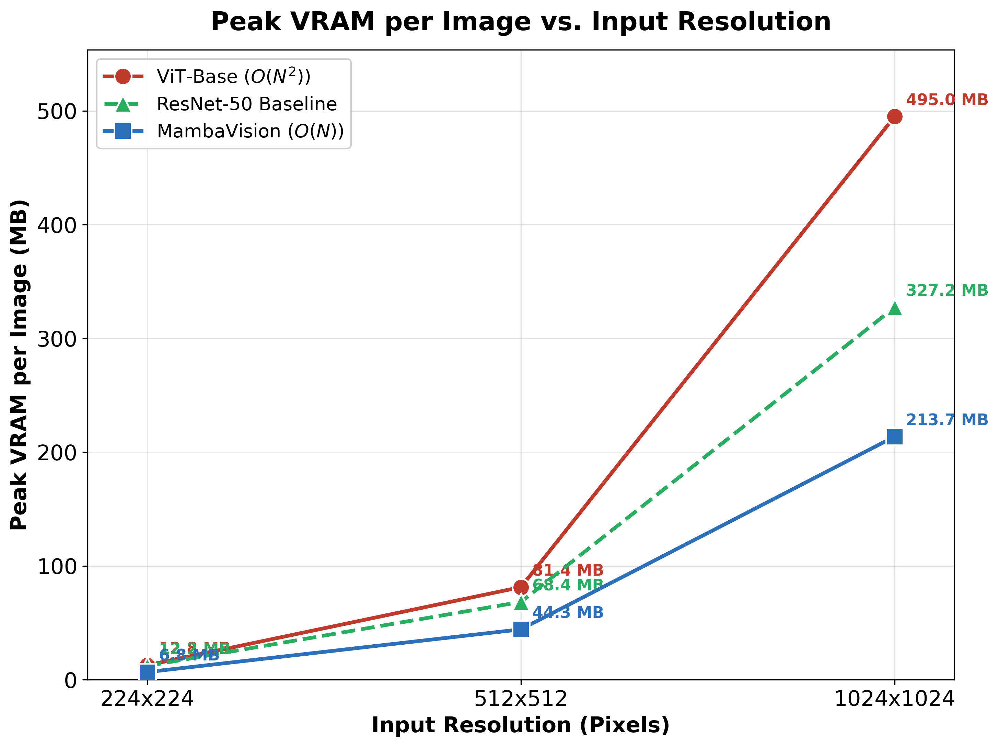

# Overcoming Spatial Context Loss in Vision Mamba

Reproducibility code for the paper **"Overcoming Spatial Context Loss in Vision Mamba: An
Architectural Analysis of 2D to 1D Data Routing"** — S. D. Monroy, M. G. Forero.
20th Colombian Conference on Computing (20CCC), Cartagena de Indias, August 2026.
Accepted for publication in Springer Nature proceedings *(DOI will be added on release)*.

Semillero de Investigación Lún · Universidad de Ibagué, Colombia.

## What it measures

Vision Transformers scale quadratically, O(N²), with the number of image patches, which makes
high-resolution medical images (1024×1024) expensive. Visual State Space Models flatten the 2D
image into 1D sequences and use multidirectional routing (Cross-Scan) to recover spatial
context while keeping linear cost, O(N). This code quantifies that trade-off empirically:
accuracy on histopathology (PathMNIST) plus asynchronous GPU profiling of memory, latency and
throughput at high resolution.

| Metric (PathMNIST / 1024×1024 profiling) | ViT-Base | ResNet-50 | MambaVision-T |
|---|:--:|:--:|:--:|
| Top-1 accuracy (linear probing, 3 seeds) | 89.13 % | 85.84 % | **88.66 %** |
| Macro F1 | — | — | 84.32 % |
| Peak VRAM per image @ 1024² | 495.01 MB | — | **213.68 MB** (−56.8 %) |
| Inference throughput @ 1024² | 3.90 FPS | — | **23.17 FPS** (≈6×) |



**Scope note.** The state-space backbone evaluated is **MambaVision-T** (a hybrid
Mamba–Transformer), used as the closest accessible hierarchical VSSM checkpoint; the claims are
tied to that checkpoint, not to the reference VMamba implementation. Only ablation (c) drives the
genuine VMamba selective-scan kernel. Hardware profiling at 512/1024 uses synthetic tensors (pure
computational profiling, not diagnostic accuracy).

## What it produces

| Output (`outputs/`) | Paper element |
|---|---|
| `env.json` | Reproducibility paragraph (torch / CUDA / GPU versions) |
| `params.csv` | Parameter counts |
| `hardware.csv` | VRAM, latency and FPS numbers and figures |
| `accuracy_raw.csv`, `accuracy_summary.csv` | Accuracy table (mean ± std over 3 seeds) |
| `ablation_toy.csv` | Ablation (a): controlled 1/2/4-direction scan accuracy |
| `ablation_proxy.csv` | Ablation (b): proxy Cross-Scan latency overhead |
| `ablation_vmamba_real.csv` | Ablation (c): real VMamba scan ablation (optional) |

## Usage

```bash
python -m venv .venv && source .venv/bin/activate
pip install -r requirements.txt

python run_all.py --quick                     # smoke test: 1 seed, 2 epochs
python run_all.py                             # full run
python run_all.py --only accuracy hardware    # subset

# Optional ablation (c) with the real VMamba kernel:
git clone https://github.com/MzeroMiko/VMamba
(cd VMamba/kernels/selective_scan && pip install .)
export VMAMBA_REPO=$PWD/VMamba
python ablation_vmamba_real.py
```

PathMNIST is downloaded automatically through the `medmnist` package.

## Follow-up work

A controlled comparison of six parameter-matched CNN and Mamba models on clinical skin-lesion
classification: [mamba-vs-cnn](https://github.com/GITHUB_USER/mamba-vs-cnn).

## Citation

```bibtex
@inproceedings{monroy2026spatial,
  title     = {Overcoming Spatial Context Loss in Vision Mamba: An Architectural Analysis of 2D to 1D Data Routing},
  author    = {Monroy, Sergio D. and Forero, Manuel G.},
  booktitle = {20th Colombian Conference on Computing (20CCC)},
  publisher = {Springer Nature},
  year      = {2026},
  note      = {Accepted for publication}
}
```
